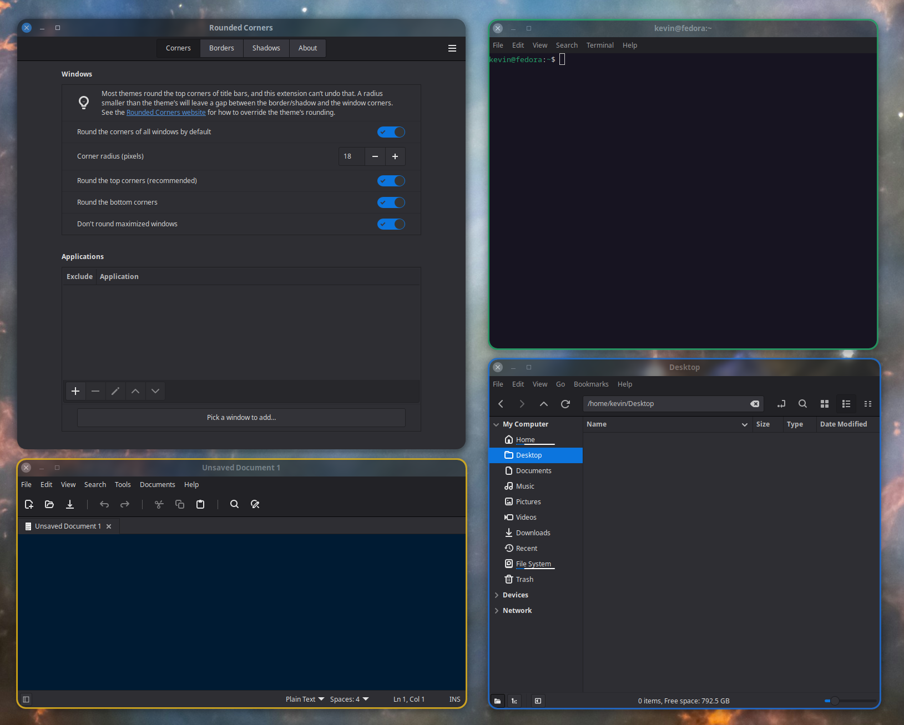

# Cinnamon Rounded Corners



A Cinnamon extension that allows you to round the corners of windows with custom borders and shadows

**Status: Stable.**

Also available on Cinnamon Spices:

https://cinnamon-spices.linuxmint.com/extensions/view/117 

## Installation:

<u>For the Cinnamon Spices version: </u>

1. Open `System Settings` -> `Extensions` -> `Download tab` -> `Rounded Corners`

2. Press the `Install` button on the right of the `Rounded Corners` list entry.

3. Return the the `Manage tab` select the `Rounded Corners` list entry.

4. Press the `Enable` / `+` button at the bottom of the window.

<u>For the Github version:</u>

Add a soft link to the RoundedCorners@klangman directory to your Extension folder. From the directory where you cloned this repo type:

```
ln -s $PWD/RoundedCorners@klangman/ ~/.local/share/cinnamon/extensions/RoundedCorners@klangman
```

Then follow the instructions for the Cinnamon Spices version skipping the Install step.

## Requirements

This extension requires Cinnamon 6.0 or better (i.e Mint 21.3 or better).

## Removing Theme's Rounded Corners:

The **Rounded Corners** extension can <u>not</u> square off corners that are already rounded by the systems Applications Theme. 

But you can override the theme's rounding using the files `~/.config/gtk-3.0/gtk.css` and `~/.config/gtk-4.0.gtk.css`. 

The CSS code below will remove the title bar rounding completely so that you can use the **Rounded Corners** extension to define whatever rounding you like, even a rounding radius that is less than the themes default radius. It also removes borders.

**<u>~/.config/gtk-3.0/gtk.css</u>**

```css
/* 1. Square off the title-bars for Gtk3 applications */
headerbar, .titlebar {
    border-radius: 0px;
    border-top-left-radius: 0px;
    border-top-right-radius: 0px;
    border: none;
    box-shadow: none;
}

/* 2. Window decorations only - skip popups (combobox/menu dropdowns) and tooltips,
      whose 1px border is drawn by the decoration's box-shadow */
window.csd:not(.popup):not(tooltip),
window.csd:not(.popup):not(tooltip) > decoration,
window.solid-csd > decoration,
window.ssd > decoration,
window.ssd > decoration:backdrop {
    border-radius: 0px;
    border-top-left-radius: 0px;
    border-top-right-radius: 0px;
    box-shadow: none;
}
```

**<u>~/.config/gtk-4.0/gtk.css</u>**

```css
window {
    --window-radius: 0px;
    border-radius: 0px;
}
```

## Credits:

Developed By: Kevin Langman

The Rounded Corners effect code is borrowed from the Blur-My-Shell Gnome Extension.

The Shadow shader is 100% Claude AI generated

Claude was used to assist (speed up) development
